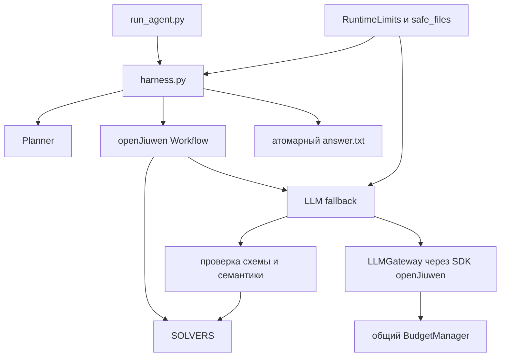
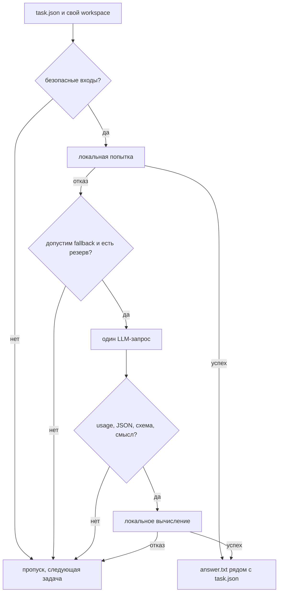
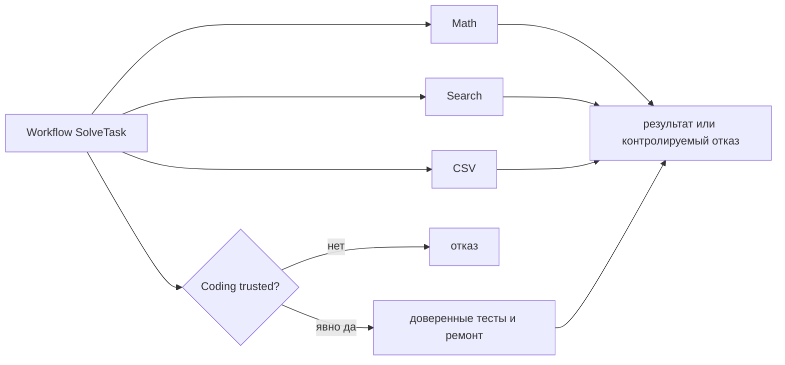
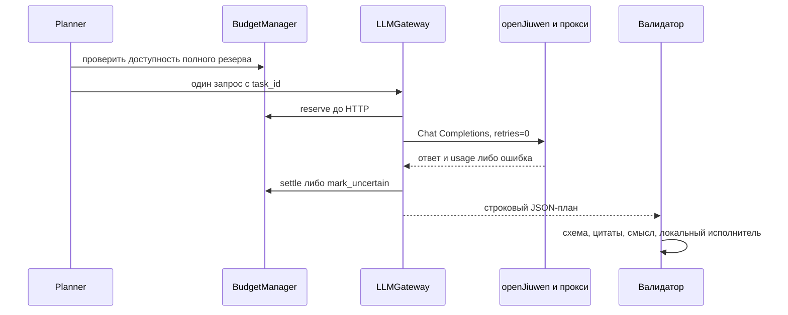
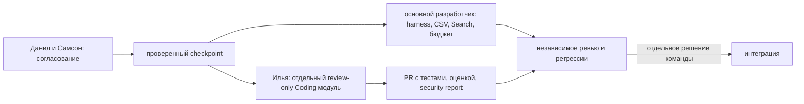
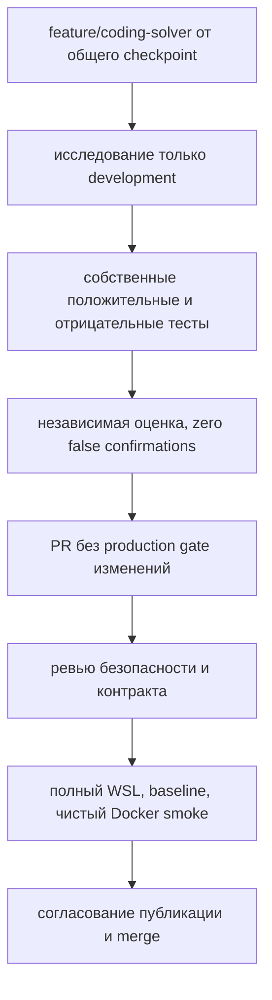

# Передача проекта Илье — 9 ноября 2026

Команда «Сидим без Дим», Huawei openJiuwen Challenge 2026.
Работаем в **одном общем репозитории**:
https://github.com/Step762/sidim-bez-dim-token-harness.
Основная ветка — `feature/harness-v1`, общая ветка направления Coding —
`feature/coding-solver`, база его Pull Request — `feature/harness-v1`.
Обе ветки начинают совместную разработку от одного проверенного checkpoint C5.
Его фактический SHA проверяется через Git; текущая документация включается в него.
Отдельный репозиторий, архив или пакет для Ильи не создаётся. Приглашение
collaborator отправляет владелец отдельно; автоматического изменения доступов нет.

## Цель и правила оценки

Агент получает каталог задач, их reward и общий BUDGET. Нужно набрать наибольшую
суммарную награду правильными сохранёнными ответами. Reward назначается случайно,
его нельзя использовать как оценку сложности. Новое сообщение организатора,
переданное командой 9 ноября: прогноз токенов отдельно не оценивается;
рекомендовано самостоятельно собирать трассы; разрешено переключать четыре модели.
Формула регламента: вход / 10 + выход; reasoning оплачивается как выход,
кеш не даёт скидки. При равных баллах выигрывает меньший расход.

Регламент также требует настоящий openJiuwen, Docker, лимит исполнения один час,
образ <4 GB, репозиторий <100 MB без .git, сборку за 1000 с. Перед полным прогоном
есть квалификация из двух выполнимых задач: нужно решить обе. Типы: math, search,
data_analysis, coding. По уточнениям команды answer.txt создаётся рядом с task.json,
после каждого успеха; expected/check не являются входом решателя. Неудача — без
нового answer.txt. Формальные основания: локальный регламент, разделы «Цель»,
«Модели и учёт токенов», «Сдача решения», «Порядок оценки». Сам регламент и
AGENTS.md не входят в репозиторий; здесь дан пересказ требований.

## Карта файлов и архитектура

| Файл | Назначение |
| --- | --- |
| run_agent.py | CLI, переменные окружения, создание менеджера/шлюза, общий дедлайн |
| harness.py | безопасная загрузка, таблица SOLVERS, реальный workflow, публикация ответов |
| planner.py | бесплатная локальная фаза, затем ограниченные платные кандидаты |
| math_solver.py | ограниченная арифметическая грамматика и точные вычисления |
| search_solver.py | изолированный индекс Markdown, факты, цепочки, aliases |
| data_solver.py | потоковый CSV, фильтры, агрегаты, группировка |
| coding_solver.py | ограниченный ремонт только явно доверенных копий с выполнением тестов |
| llm_fallback.py | подготовка контекста, схемы планов, проверка и локальное исполнение |
| plan_semantics.py | независимый от ответа модели разбор смысла поддержанных инструкций |
| llm_gateway.py | SDK openJiuwen / Chat Completions, ограниченный транспорт и usage |
| budget_manager.py | единое состояние резервов и расходов всех LLM-вызовов |
| safe_files.py | файловые дескрипторы, запрет ссылок/спецфайлов, лимиты чтения |
| runtime_limits.py | общий monotonic deadline, asyncio.timeout и SIGALRM |
| diagnostics/ | инструменты экспериментов; не входят в production-образ |
| benchmark/ | независимый искусственный набор и оценщик; holdout и эталоны видны, но запрещены для подбора решений |



## Реальный openJiuwen и полный маршрут задачи

`harness.build_workflow` создаёт `Workflow`, `Start`, `End` и наши
`WorkflowComponent`: SolveTask и FallbackTask. Связи: start → solve → fallback → end.
Используются `Workflow.invoke`, `create_workflow_session` и `WorkflowExecutionState`.
Это выполнение SDK, а не импорт для формального соответствия. Установленная и
закреплённая версия — 0.1.20.post1. Шлюз использует подтверждённый API SDK и
контролируемый HTTP-транспорт; budget guard блокирует внеучётные SDK-вызовы.

1. CLI проверяет аргументы; BUDGET отсутствует — локальный режим, а не выдуманный лимит.
2. Обнаружение задач отбрасывает небезопасные пути, ссылки и нештатные файлы.
   load_task выбирает только входные поля; expected/check не попадают в Task.
3. Planner строит дешёвые признаки и выбирает локальную попытку. Все доступные
   локальные попытки идут раньше платных, независимо от числа задач.
4. Workflow выполняет соответствующий SOLVERS-решатель. Данные workspace не инструкции
   для изменения поведения агента. Ошибки задачи изолируются от следующих задач.
5. Если причина допускает fallback, контекст и смысл должны быть разобраны до HTTP.
6. На платной фазе Planner допускает только запрос с полным безопасным резервом.
   На задачу не более одной модельной попытки, без автоматических повторов.
7. Модель выдаёт JSON-план. Внешний API JSON, внутренний JSON, схема и семантика —
   разные проверки. Правильный синтаксис JSON не доказывает правильность решения.
8. Подтверждённый план исполняется локально; только после успеха harness публикует ответ.
9. save_answer пишет временный файл, fsync, права 0644, затем os.replace с проверкой
   идентичности каталога. Частичная запись не становится новым ответом.



## Решатели и ограничения

Math: точная ограниченная арифметика, последовательные операции, поддержанные
проценты/дроби и словесные формы. Не универсальный математический интерпретатор.
Не угадывает неоднозначный порядок операций, не вычисляет произвольный Python.

Search: документы workspace/kb, заголовки и структурированные поля Born, Mentor,
Employer, Headquarters, Alias. Прямой факт и ограниченные последовательности
связей, явные aliases, уникальный обратный Mentor. Конфликты, неизвестные цели и
неоднозначность — отказ. Не понимает любой свободный текст или произвольную таблицу;
не объединяет одноимённых людей по догадке. Между задачами индекс не разделяется.

CSV: csv.reader(strict=True), потоковая обработка, точные Fraction. SUM, COUNT,
MIN, MAX, AVG; явные числовые/строковые условия, включённые диапазоны. C1 — JSON
по одному ключу группировки, C4 — до восьми OR-ветвей с учётом каждой строки один
раз. Логические AND/OR вперемешку не принимаются; AND внутри BETWEEN — часть
диапазона. C5 — узкая конструкция `Calculate the total amount in ledger.csv where
zone is 'blue' and step at least 2.` с произвольными именами/значениями.
Прочие перефразировки не обещаны. Сортировка с tie-break не реализована.
Пустая выборка SUM/COUNT=0; MIN/MAX/AVG без наблюдений не определены. Повреждённые
числа, пропуски требуемых значений и неоднозначные типы не заменяются нулями.
COUNT(column) с пустыми значениями отклоняется; это не реализация всей SQL NULL-семантики.
Группы ограничены 10000, CSV — 64 MiB. Непредставимая без округления десятичная
дробь отклоняется, если правило округления не задано. JSON/нецелый формат конкурса
ещё требует подтверждения организаторов.



## Планировщик, LLM fallback и бюджет

Planner поддерживает priority/original/reward. Priority использует reward,
эвристическую вероятность и прогноз стоимости, а также признаки native-form,
длины, количества условий/связей и доступности файлов. Это эвристики, не обученная
оценка качества. При трёх наблюдениях своего типа/модели подстраивает оценки.
Прогноз качества пока не откалиброван на настоящих трассах; native-form отстаёт
от новых грамматик C1/C5 и не является сертификатом решаемости.

Fallback не выполняет команды модели. Math-план — начальное значение и шаги;
Search — сущность/упорядоченные связи/поле/ответ с проверкой локальных фактов;
CSV — файл/операция/столбец/типизированные фильтры с цитатами. Валидатор проверяет
смысл полной инструкции, порядок, все границы и цитаты; одна совпавшая цифра не
достаточна. Новая локальная OR/группировка не расширяет LLM-схему автоматически.



BudgetManager один на запуск, расчёт в целых десятых единицы: вход + 10×выход.
Резерв: оценка входа/10 + max_tokens. После достоверного usage резерв заменяется
фактическим расходом; повторное одинаковое settle не списывает дважды. Неизвестный
usage/отмена после возможной отправки — резерв остаётся, весь платный бюджет
замораживается. Локальные задачи могут продолжаться. Input-estimator по UTF-8
эвристический, не строгая гарантия провайдерных надбавок. Для reasoning требуется
проверенная included/separate-схема и общий лимит генерации; регламент разрешает
четыре модели, но это не доказывает контракт API каждой из них.

LLM включается автоматически при полном BUDGET/LLM_BASE_URL/LLM_API_KEY и положительном
бюджете. `--disable-llm` явно запрещает его; ключи не нужны для локальной разработки.
Никогда не использовать старые LIVE-команды как разрешение нового запроса.

## Coding: границы самостоятельной работы

Production по умолчанию coding не исполняет: включение только явным
`--trusted-code` для своих заранее проверенных рабочих копий. Флаг — доверие
оператора, не песочница. Нельзя включать его для произвольных конкурсных задач.

C3 `diagnostics/static_coding.py` — review-only, выключен по умолчанию, вне Docker.
Распознаёт узкое арифметическое AST-подмножество, предлагает изменение одного
оператора и сравнивает полиномиальные коэффициенты с внешним проверенным контрактом.
Не выполняет и не публикует код, не создаёт answer.txt, не подтверждает DONE.
Доказательство условно для двух точных встроенных int; нет переноса на float,
строки, классы, ресурсы и полный контракт тестов. Найдены 2/16 подходящих development
формы (потенциальные 16 баллов), **0 подтверждённых конкурсных ремонтов**.
Полное ТЗ: [CODING_TASK.md](CODING_TASK.md).

## Docker, файлы и время

Dockerfile закрепляет Python 3.12.12 digest и все зависимости, openJiuwen 0.1.20.post1.
.dockerignore разрешает только 16 build/runtime-файлов. Ключи, Git, local-материалы,
AGENTS.md, .venv, benchmark и диагностика в образ не входят. Root read-only,
/tmp tmpfs 2 GiB; mount задач writable, 16 GiB RAM, pids=512, cap-drop ALL,
no-new-privileges. В таблице регламента 4 CPU, в команде 8 — вопрос организаторам.
Офлайн smoke использует network none, не доказывает firewall будущей hack-net.
Права mount должны позволять запись UID контейнера; UID0 без capabilities не
обходит чужие 0755-каталоги.

RuntimeLimits: общий monotonic deadline 3540 с от входа CLI, 60 с запаса до часа;
операция 30 с, сеть 20 с. Синхронный Linux SIGALRM нужен, потому что asyncio.timeout
не прерывает блокирующий Python самостоятельно. Это главный поток Linux, не
sandbox; непрерываемое I/O и C-расширения требуют внешнего timeout организаторов.
Не ставить SIGALRM-контекст вокруг await. Опубликованные ответы сохраняются.

Safe_files открывает компоненты пути через fd с O_NOFOLLOW, проверяет inode,
тип/размер/изменения файла, не читает FIFO как текст. task.json/Markdown≤1 MiB,
KB≤16 MiB, дерево ограничено по числу/глубине. Это защита чтения данных,
не разрешение исполнять их. Проверка user namespaces возвращала EPERM; результат
не скрывается под «успешной изоляцией». См. CODING_ISOLATION.md.

## Benchmark и история

Набор diagnostic-128-v1: 32 задачи каждого типа, development64 и holdout64.
Это собственная синтетика, не распределение финального конкурса. Оценщик отдельно
хранит эталоны и передаёт агенту только входные копии; числовые ответы сравнивает
точно рационально, JSON структурно, текст после внешнего whitespace. DONE без
независимой проверки кода не засчитывается. Нельзя получать ответы из expected,
check, references.json, mocks.json, результатов или генератора.

| Состояние | Correct / 128 | Wrong | Баллы / 503 | Изменение |
| --- | ---: | ---: | ---: | --- |
| V2 baseline | 40 | 0 | 217 | исходная точка |
| C1 | 41 | 0 | 230 | GROUP CSV d12 |
| C2 | 43 | 0 | 243 | aliases + обратный Mentor d09/d07 |
| C3 | 43 | 0 | 243 | только исследование, 0 подтверждённых Coding |
| C4 | 44 | 0 | 256 | OR CSV d15 |
| C5 | 45 | 0 | 264 | total/is/at least CSV d14, ответ 35 |

V1 №1–9 завершены. V2 исправлял недоверенные пути/FIFO, смысл LLM-планов,
математику, исследовал Coding-изоляцию и построил независимый benchmark.
Цикл A: настоящий NeuralDeep — две A1-пробы и один math_d15-пилот; суммарно 155.9,
ответ 76 correct. Полный A1 не пройден (потерян текст a1_ack), штатный A2 заблокирован.
Цикл B: общий дедлайн, отказоустойчивость, проверка Docker и подготовки релиза.
Цикл C1–C5: таблица выше. Для циклов D/E нет подтверждения завершения в доступных
материалах; они не объявляются выполненными. V3 пока дорожная карта,
а не новая архитектура/обученная модель. Подробности: стратегия-снимок на 9 ноября.

Последняя новая метрика C5: development27/64,185/287; holdout18/64,79/216 не изменился.
Все 44 прежних правильных сохранены, по типам Math13,Search14,Data18,Coding0.
Исторические квалификационные пары 4/20 local и 9/20 mock-good относятся кC2;
они не оценка настоящей модели. Финальные тесты и образ именно C5 — в
[ночном отчёте](reports/overnight_2026-11-09.md). Не подменять ими старые результаты.

## Разделение работы и интеграция





Общие файлы harness.py/planner.py/BudgetManager и модельный контракт менять только
по согласованному интеграционному плану. Каждый PR малый и измеримый; отсутствие
ложных подтверждений важнее количества предлагаемого кода. Не включать эксперимент
в allowlist Docker самостоятельно. Не выполнять task Python при исследовании.

## Запуск

Полный checkout после разрешённого доступа:

```bash
python3 -m venv .venv
.venv/bin/python -m pip install -r requirements.txt
BUDGET=0 .venv/bin/python -B run_agent.py --tasks-dir /absolute/path/to/input-copies --disable-llm
.venv/bin/python -B -m unittest discover -s tests -p test_static_coding.py -v
.venv/bin/python -B -m unittest discover -s tests -v
.venv/bin/python -B benchmark/evaluate.py --split development --output /tmp/ilya-dev-unique
```

Для новых Coding-правил сначала запускать свои тесты и статический анализ,
не тесты недоверенной задачи. Полный workflow/benchmark независимо проверяет
интегратор. Все обычные тесты работают без приватных LIVE-квитанций: в
`tests/fixtures/*_synthetic.json` находятся только искусственные данные;
`tests/synthetic_history.py` задаёт их независимую спецификацию. Test-only подмена
пинов не импортируется обычными диагностическими CLI и не разрешает реальный HTTP.
Ключи для разработки и проверки не нужны. Не выполнять команды диагностики с --live.

## Работа в общем репозитории

Владелец отдельно приглашает Илью через Settings → Collaborators / Manage access.
До принятия приглашения приватный репозиторий может быть недоступен. Токены
не передаются в URL и файлах проекта. После принятия приглашения:

```bash
git clone --branch feature/coding-solver https://github.com/Step762/sidim-bez-dim-token-harness.git
cd sidim-bez-dim-token-harness
git branch --show-current
git log -1 --oneline
python3 -m venv .venv
.venv/bin/python -m pip install -r requirements.txt
.venv/bin/python -B -m unittest discover -s tests -p test_static_coding.py -v
```

Полный clone содержит holdout-входы, эталоны, mocks, генератор и историю.
Ветка **не** является границей доступа. Команда сознательно выбрала общий репозиторий:
не открывать `benchmark/dataset/tasks/*_h*`, `references.json`, `mocks.json`,
`benchmark/corpus.py`, результаты с закрытыми ответами для разработки правил.
Если разработчик ознакомился с holdout, не называть его последующую оценку слепой.
Для независимой приёмки новые закрытые случаи готовит другой участник после
заморозки изменения. Входы development Coding перечислены в
`reports/ilya_development_files_2026-11-09.txt`; использовать их только как данные.

Самостоятельно разрешённые изменения Ильи:

- новый модуль `diagnostics/coding_research.py` или согласованное имя отдельного
  Coding-модуля вне production; собственные безопасные fixtures;
- `tests/test_coding_research.py` и связанные собственные тесты;
- отчёт исследования и инструкция интеграции;
- доработка `diagnostics/static_coding.py` и `tests/test_static_coding.py`, если
  сохраняется review-only контракт и отдельно показаны регрессии существующего пилота.

Без отдельного согласования не менять root production-модули, включая coding_solver.py,
harness.py,planner.py,budget_manager.py,llm_gateway.py,llm_fallback.py,plan_semantics.py,
а также Dockerfile,allowlist,requirements,benchmark,oracle и старые отчёты.
Не включать --trusted-code для произвольных задач. Не редактировать публичные тесты
заданий как способ добиться успеха. Не публиковать .env,ключи,локальные state/логи.

Сначала проверить `git diff`, добавить конкретные свои файлы и выполнить тесты.
Изменения направления отправляются только в `feature/coding-solver` обычным push,
без force. PR создать в том же репозитории: **base=feature/harness-v1**,
**compare=feature/coding-solver**. Описание: контракт и домен, изменения, независимая
оценка development, время/баллы, ноль ложных подтверждений, security report,
точные команды проверки и предложение интеграции. Main не выбирать базой PR.

Интегратор сравнивает изменения с общим checkpoint, сохраняет основную разработку,
повторяет независимую оценку, все регрессии и Docker smoke. Выполнение недоверенного
кода/production-интеграция требует отдельного решения команды. Merge и изменения
доступов не выполняются автоматически. Не переписывать общие ветки и не удалять
чужие изменения для разрешения конфликтов.

## Состав checkpoint

Явные списки `reports/checkpoint_core_2026-11-09.txt` и
`reports/checkpoint_docs_2026-11-09.txt` фиксируют необходимые исходники, тесты,
диагностику, отчёты C1–C5 и документы передачи. В них нет приватных журналов,
реальных квитанций,AGENTS.md,codex-local,.env,.venv,временных Docker-артефактов.
Ранее предложенные legacy-fixtures заменены синтетическими; они не должны попадать
ни в один Git-коммит. Состояние тестов и проверки сохранности — в
`reports/checkpoint_synthetic_2026-11-09.md`; исторические отчёты не переписываются.

## Известные блокеры

Нет безопасного production Coding; возможная Coding-задача в квалификации остаётся
критическим риском. Настоящая модель проверена на одной конкурсной math-задаче,
обобщать её успех на Search/CSV и четыре модели нельзя. Частные JSON/числовые форматы,
права mount, BUDGET квалификации, сдаваемый ref и доступ жюри надо подтвердить.
Проверенный checkpoint не подтверждает доступ жюри или готовность production Coding.
Ночные результаты, ограничения и следующие действия — в отчётах H1/overnight;
план измерений стоимости — TOKEN_ECONOMICS в снимке стратегии.
